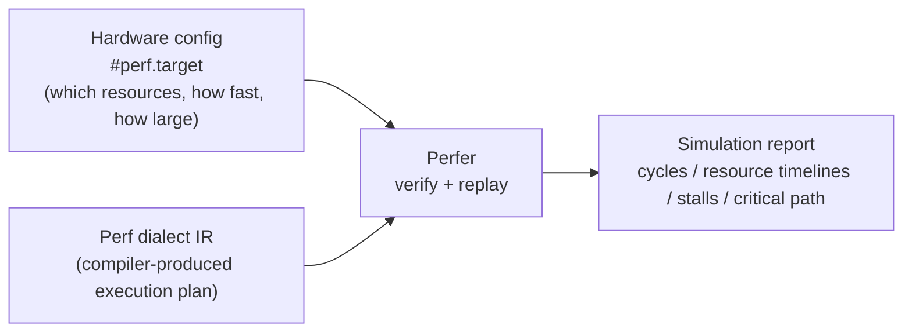

# Perfer

Perfer is a discrete-event, instruction-level performance simulator built on MLIR, which could be used on the development of  AI Compier and DSE porcess. It reads a compiler-produced execution plan (Perf dialect IR) plus a hardware configuration, replays each instruction against the cost model derived from that configuration—when it starts, when it finishes, which resources it occupies—and reports total cycles, resource timelines, stall attribution, and the critical path.



Perfer replays and never schedules. instruction order, resource assignment, and buffer layout are all fixed by the compiler in the IR, and Perfer makes no decisions of its own. Given the same config and the same IR, the result is always identical.

## Contents

- [How it differs from other tools](#how-it-differs-from-other-tools)
- [Use cases](#use-cases)
- [Config and IR example](#config-and-ir-example)
- [Accuracy targets and calibration](#accuracy-targets-and-calibration)
- [Design principles](#design-principles)
- [Build & quick start](#build--quick-start)
- [Docs](#docs)
- [Contributing](#contributing)
- [License](#license)

## How it differs from other tools

| Tool                          | Modeling granularity                | Input                                     | Typical use                                                  |
| ----------------------------- | ----------------------------------- | ----------------------------------------- | ------------------------------------------------------------ |
| Spike                         | functional                          | binary program                            | verifies results, no timing model                            |
| Verilator / FireSim           | RTL / cycle-accurate                | RTL design                                | exact timing, slow                                           |
| SCALE-Sim                     | cycle-level systolic model          | layer shape + array config                | array utilization, memory analysis                           |
| STONNE                        | cycle-level microarchitecture model | layer description + arch config           | microarchitecture evaluation of reconfigurable accelerators  |
| Timeloop / Accelergy, MAESTRO | analytical model                    | abstract mapping + arch description       | mapping-space and architecture-space search                  |
| **Perfer**                    | discrete-event                      | compiler-emitted Perf dialect IR + config | evaluates real compiler artifacts on a given hardware target |

Compared with analytical simulators, Perfer consumes the compiler's actual output rather than an abstract mapping, so it can show exactly where bubbles appear, why stalls happen, and which path is critical. Compared with RTL simulation, Perfer does no real computation and only replays timelines, so it should be much faster (the exact speedup is TBD by benchmark).

## Use cases

### Compiler optimization

Perfer plays a role similar to perf or VTune on CPUs: it answers whether the IR produced by an AI compiler got faster or slower, and why. Common cases:

- **Before/after comparison**: run Perfer on the IR before and after a change; comparing total cycles, per-resource busy/idle, and critical paths shows exactly where the gain came from and where the cost went.
- **Finding why it's slow**: the timeline shows which DMA the array is waiting on, which channel is saturated, and where bubbles appear. Stall attribution pins "why slow" to specific instructions and resources.
- **Performance regression testing**: replay is deterministic—no measurement noise, same input, same result. Put a set of benchmark IRs in CI and compare cycle counts on every commit; any change means the compiler's output changed.
- **No hardware required**: before tape-out, or when hardware is scarce, the compiler team can keep optimizing performance as usual.
- **Trying different schedules**: a schedule is an attribute attached to the IR. Using the scheduling primitives of the Perf dialect, the same IR can carry different schedules and be simulated directly—the program body is untouched.

The same feedback also plugs into automated flows—for example, as the measurement step of an autotuning loop, or as data to train or validate the compiler's own cost model. In such settings, whether candidates are ranked correctly matters more than absolute error, so ranking fidelity is reported separately (see [Accuracy targets and calibration](#accuracy-targets-and-calibration)).

### Design space exploration (DSE)

Hardware parameters such as bandwidth, capacity, and latency live only in the configuration; the spec forbids them in the IR. As a result:

- Sweeping these parameters only means swapping the config; the IR is unchanged.
- Changing resource counts (e.g., adding DMA channels or arrays) requires the compiler to regenerate the IR.
- Busy/idle and stall attribution in the report point directly at the bottleneck resource; the knee of a sweep curve (e.g., total cycles stop improving beyond some bandwidth) is an architecture decision point.

Two caveats:

1. **Sweeping configs with a fixed IR measures "how this schedule performs on that machine", not necessarily the machine's optimum.** The schedule in the IR was generated for one configuration; as hardware parameters change, the optimal schedule may change with them. Strict DSE should let the compiler regenerate the IR for each candidate config, with Perfer evaluating each one faithfully. Since Perfer consumes the compiler's real output, anything evaluated can be reproduced by the compiler as-is.
2. **Some parameters affect the legality of the IR.** For example, `perf.alloc` fixes the scratchpad footprint in the IR; if `capacity_kib` in the config is shrunk below that footprint, verification fails with an error instead of producing a simulation result.

## Config and IR example

The config describes what the machine has, how fast, and how large:

```mlir
#target = #perf.target<
  version = 3,                      // config schema version
  target_name = "systolic_npu_v1",
  frequency_mhz = 1000,
  array      = #perf.array<mesh_rows = 16, mesh_cols = 16, ...>,
  scratchpad = #perf.sram<capacity_kib = 256, banks = 4, ...>,
  dma        = #perf.dma<bus_bytes_per_cycle = 16, fixed_latency_cycles = 20, ...>,
  resources  = [#perf.resource_family<kind = "dma_read", count = 1, ...>, ...]
>
```

The IR describes how the program executes: where buffers live, which DMA channel each transfer takes, which array computes, and who depends on whom.

```mlir
// fragment: definitions of %A, %buf_b, %acc_c and prior tokens %f0, %p0 omitted

// allocate a buffer in scratchpad instance 0 (N in space<spad, N> is the memory-instance index)
%buf_a = perf.alloc : memref<512xi8, #perf.space<spad, 0>>

// async DMA: issued after %f0 completes, uses read channel 0
%t0 = perf.dma_load %A, %buf_a [%f0]
        {bytes = 512, resource = #perf.res<dma_read, 0>} : !perf.token

// array compute: issued after %t0 and %p0 complete, uses array 0
%c0 = perf.compute %buf_a, %buf_b, %acc_c [%t0, %p0]
        {m = 16, n = 16, k = 32, accumulate = false, writeback = true,
         resource = #perf.res<array, 0>} : !perf.token
```

There are no cycle numbers anywhere in the IR. Perfer derives each instruction's cost from the structural parameters in the config via the cost model, so changing hardware parameters alone never touches the IR. See the spec for the full schedule-attribute syntax.

## Accuracy targets and calibration

Gemmini is currently the only planned calibration target, with its RTL simulation (Verilator / VCS / FireSim) as ground truth. Results for other configurations are unverified and for reference only.

| Level       | Scope                                                        | Error target                                                 | Status      |
| ----------- | ------------------------------------------------------------ | ------------------------------------------------------------ | ----------- |
| Simple ops  | matmul with one or a few tiles, straight-line IR             | ±3%                                                          | Not started |
| Complex ops | multi-tile, double-buffered, software-pipelined matmul / conv | ±5%                                                          | Not started |
| Networks    | end-to-end sequences of operator layers                      | mean and max error within ±10%, with covered layer types stated | Not started |
| LLMs        | small to mainstream-scale LLMs                               | no absolute-error commitment; trend and ranking only         | Not started |

- Simple ops are the calibration anchor: golden tests align every op's start/end cycle by cycle, and the basic parameters (DMA latency, preload, stream, fill/drain) are calibrated at this level.
- Complex ops introduce stalls and overlap, mainly exercising cross-resource bubble modeling.
- Network-level errors both accumulate and cancel, so they are reported as a distribution rather than per-layer commitments.
- For candidate-comparison scenarios (before/after, autotuning), we additionally report Kendall's τ and top-k hit rate for candidate ranking.

When errors appear, attribution follows a fixed order: DMA → preload/writeback → array stream → fill/drain → cross-resource bubbles, and the cost model and config are corrected accordingly.

## Design principles

- **Replay, never schedule**: every ordering decision lives in the IR; the simulator schedules nothing. Results are deterministic and reproducible.
- **One IR**: compiler, verifier, and simulator consume the same MLIR IR and the same config—there are no two models that can silently drift apart.
- **Pure cost model**: given one instruction and one config, it returns the instruction's timing breakdown. Stalls are not produced by formulas; they emerge during replay.
- **Assumption list**: every report carries the factors this simulation ignored (e.g., "no bank conflicts"). When RTL comparison diverges, check the list first, the formulas second.

## Build & quick start

> TBD: the implementation is not ready yet.

## Docs

- Perfer spec: to be published (planned path `docs/spec.md`)

## Contributing

> TBD: contribution guide and repository layout.

## License

Perfer is open source under the [Apache License 2.0](LICENSE).

Copyright © 2026 Perfer Authors.

## References

- [Gemmini](https://github.com/ucb-bar/gemmini)
- [SCALE-Sim](https://scalesim-project.github.io/about)
- [STONNE](https://github.com/stonne-simulator/stonne)
- [Timeloop](https://timeloop.csail.mit.edu/)
- [MAESTRO](https://maestro.ece.gatech.edu/)
- [CIRCT Simulation Dialect](https://circt.llvm.org/docs/Dialects/Sim/)
- [MLIR Transform Dialect](https://mlir.llvm.org/docs/Dialects/Transform/)
- [MLIR MemRef Dialect](https://mlir.llvm.org/docs/Dialects/MemRef/)
- [MLIR Passes](https://mlir.llvm.org/docs/Passes/)
